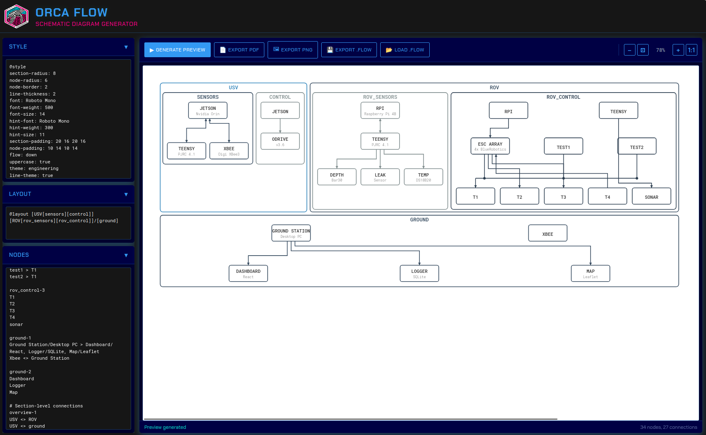
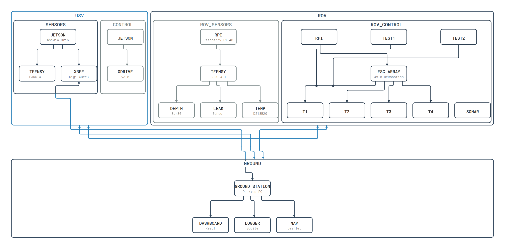

# ORCA Flow

Write a system diagram as text and get a schematic with clean, non-overlapping orthogonal wires.




## Run

```sh
cd ORCA_flow
python3 -m http.server 8000
```

Open `http://localhost:8000`, fill in the three panes on the left, then press **Generate Preview** or `Ctrl+Enter`.

| Control | What it does |
|---|---|
| **Generate Preview**, `Ctrl+Enter` | Draws the diagram. |
| **Export PNG** | Saves the diagram as a PNG. |
| **Export .flow** | Saves the three panes as one `.flow` file. |
| **Load .flow** | Opens a `.flow` file. |
| `Ctrl+Wheel`, zoom buttons | Zoom the preview. |

## A .flow file

```
@style
theme: engineering

@layout [USV[sensors][control]]/[ground]

@nodes
sensors-1
Jetson/Nvidia Orin > Teensy, Xbee/Digi XBee3

sensors-2
Teensy
Xbee

control-1
Jetson > ODrive/v3.6

control-2
ODrive

ground-1
Ground Station/Desktop PC > Dashboard, Logger

ground-2
Dashboard
Logger

links-1
Xbee <> Ground Station
USV <> ground
```

## Layout

| Pattern | Meaning |
|---|---|
| `[a][b]` | `a` and `b` side by side. |
| `[a]/[b]` | `a` above `b`. |
| `[Name[a][b]]` | A box called `Name` holding `a` and `b`. |

## Nodes

- A header `section-row`, such as `sensors-1`, starts a row inside that section.
- The node on the left of a line sits on that row.
- Every node needs a row. List each target by name under a later row header, or it is not drawn.
- `Name/hint` adds a smaller second line to a node. It can go on either mention.
- A line with no symbol places a node with no new links.
- Commas give one node several targets: `Teensy > GPS, IMU`.
- Lines starting with `#` are comments.

| Symbol | Wire |
|---|---|
| `>` | Arrow to the target. |
| `<` | Arrow from the target. |
| `<>` | Arrows both ways. |
| `->`, `<-`, `<->` | The same, dashed. |

## Linking across sections

- A directional line (`>`, `<`, `->`, `<-`) creates and links nodes inside its own section only.
- A two-way line (`<>`, `<->`) links nodes that already exist, in any section. It creates nothing.
- Write `section:Name` to reach a node in another section with any symbol, for example `top:Filter > bottom:Logger`.
- Use the qualified form when a name exists in more than one section. A name that matches several sections is reported, not guessed.
- A section or box name links the box itself: `USV <> ground`.
- Links can live in a section the layout never draws, such as `links-1`.
- Unresolved names are listed in a popup after **Generate Preview**.

## Settings

Write these in `@style` as `key: value`. Numbers may carry a unit, such as `14px`; only the number is used.

| Setting | Range | Default | What it does |
|---|---|---|---|
| `theme` | `default`, `monochrome`, `engineering`, `warm`, `cool`, `high-contrast` | `engineering` | Colours given to the boxes in order. |
| `font` | any Google Font | `Roboto Mono` | Node and box label font. |
| `font-weight` | 100 to 900 | `500` | Node and box label weight. |
| `font-size` | any number | `14` | Node label size in px. Box labels are 2px larger. |
| `hint-font` | any Google Font | `Roboto Mono` | Hint line font. |
| `hint-weight` | 100 to 900 | `300` | Hint line weight. |
| `hint-size` | any number | `11` | Hint line size in px. |
| `uppercase` | `true`, `false` | `true` | Shows node and box labels in capitals. |
| `node-min-width` | any number | `120` | Node width in px. |
| `node-padding` | 1, 2 or 4 numbers | `10 14 10 14` | Space inside a node in px, top right bottom left. |
| `node-radius` | any number | `6` | Node corner radius in px. |
| `node-border` | any number | `2` | Node outline width in px. |
| `section-radius` | any number | `8` | Box corner radius in px. |
| `section-border` | any number | `2` | Box outline width in px. |
| `line-thickness` | any number | `2` | Wire width in px. |
| `line-spacing` | any number | `15` | Space between parallel wires in px. |
| `corner-radius` | any number | `4` | Wire corner radius in px. |
| `page-margin` | 1, 2 or 4 numbers | `10 10 10 10` | Space around the diagram in mm, top right bottom left. |

## Tests

Run from the repo root. The screenshot check needs Chrome and ImageMagick.

```sh
node test/router.test.js
node test/levels.test.js
node test/screenshot.js cross /tmp/orca-shots
```

Fixtures are in `test/fixtures/`.
