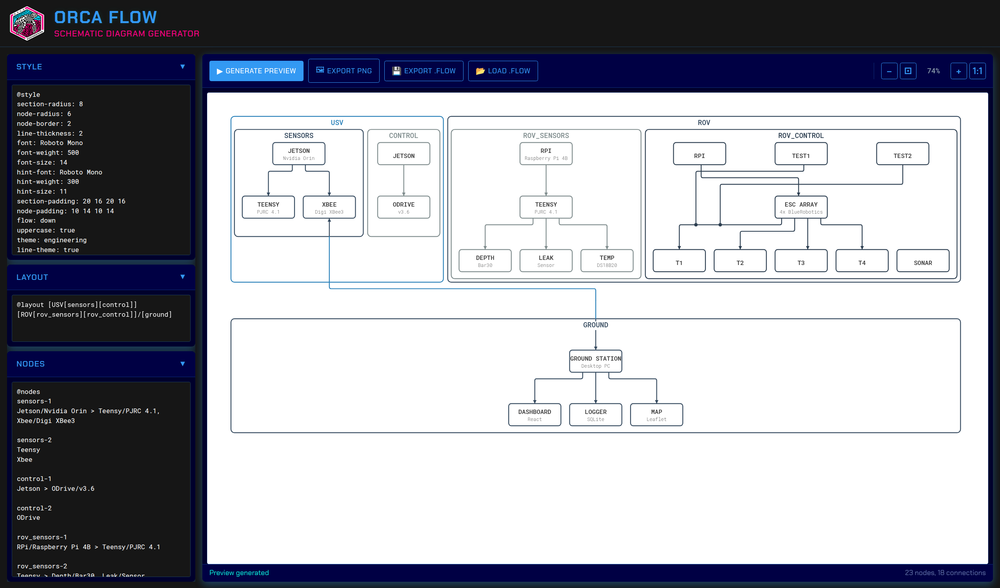
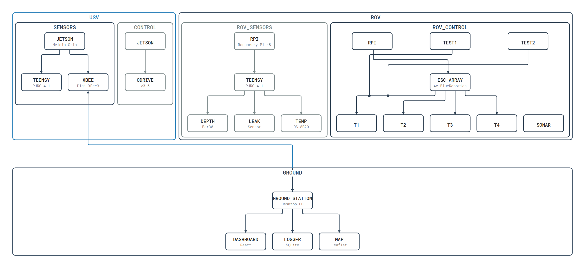

# ORCA Flow

Write a system diagram as text and get a schematic with clean, non-overlapping orthogonal wires.




## Run

From the folder holding `index.html`:

```sh
python3 -m http.server 8000
```

Open `http://localhost:8000`, fill in the three panes on the left, then press **Generate Preview** or `Ctrl+Enter`.

| Control | What it does |
| --- | --- |
| **Generate Preview**, `Ctrl+Enter` | Draws the diagram. Unresolved names are listed in a popup. |
| **Export PNG** | Saves the diagram as a PNG. |
| **Export .flow** | Saves the three panes as one `.flow` file. |
| **Load .flow** | Opens a `.flow` file. |
| `Ctrl+Wheel`, zoom buttons | Zoom the preview. |

## Example

```text
@style
theme: engineering

@layout [USV[sensors][control]]/[ground]

@nodes
sensors-1
Jetson/Nvidia Orin > Teensy, Xbee/Digi XBee3

sensors-2
Teensy
Xbee

control-1
Jetson > ODrive/v3.6

control-2
ODrive

ground-1
Ground Station/Desktop PC > Dashboard, Logger

ground-2
Dashboard
Logger

links-1
Xbee <> Ground Station
USV <> ground
```

## Syntax

| Write | Where | What it does |
| --- | --- | --- |
| `[a][b]` | `@layout` | Puts sections `a` and `b` side by side. |
| `[a]/[b]` | `@layout` | Puts `a` above `b`. |
| `[Name[a][b]]` | `@layout` | Draws a box called `Name` around `a` and `b`. |
| `sensors-1` | `@nodes` | Starts row 1 of section `sensors`. Lines below it go on that row. |
| `Teensy` | `@nodes` | Places a node on the current row with no new links. Every node needs a row, so list each target under a later row. |
| `Name/hint` | `@nodes` | Adds a smaller second line to a node. Works on either mention. |
| `A > B` | `@nodes` | Wire with an arrow from `A` to `B`. |
| `A < B` | `@nodes` | Wire with an arrow from `B` to `A`. |
| `A <> B` | `@nodes` | Wire with arrows both ways. |
| `->`, `<-`, `<->` | `@nodes` | The same three wires, dashed. |
| `A > B, C` | `@nodes` | Links one node to several targets. |
| `section:Name` | `@nodes` | Reaches a node in another section, for example `top:Filter > bottom:Logger`. Needed when a name exists in more than one section. |
| `USV <> ground` | `@nodes` | Links two boxes or sections by name. |
| `links-1` | `@nodes` | A section the layout never draws, used to hold cross-section links. |
| `B {#e6194b}` | `@nodes` | Colours that wire's whole trace. Goes after a target. Accepts `#rgb` and `#rrggbb` only. |
| `# text` | any pane | A comment. |

- A directional line (`>`, `<`, `->`, `<-`) creates and links nodes inside its own section only.
- A two-way line (`<>`, `<->`) links nodes that already exist, in any section, and creates nothing.
- A trace is one wire across every box it crosses, plus any wires sharing its bus. A trace has one colour.

## Settings

Write these in `@style` as `key: value`. Numbers may carry a unit, such as `14px`, and only the number is used.

| Setting | Range | Default | What it does |
| --- | --- | --- | --- |
| `theme` | `default`, `monochrome`, `engineering`, `warm`, `cool`, `high-contrast`, `kelly`, `okabe-ito` | `engineering` | Colours given to the boxes in order. |
| `line-theme` | `box`, `custom`, or any `theme` name | `box` | Wire colours. `box` draws each wire in its box colour. Any other value gives every trace its own colour from that palette. |
| `line-palette` | comma-separated hex colours | none | The palette for `line-theme: custom`, for example `#e6194b, #3cb44b, #4363d8`. |
| `font` | any Google Font | `Roboto Mono` | Node and box label font. |
| `font-weight` | 100 to 900 | `500` | Node and box label weight. |
| `font-size` | 0 to 10000 | `14` | Node label size in px. Box labels are 2px larger. |
| `hint-font` | any Google Font | `Roboto Mono` | Hint line font. |
| `hint-weight` | 100 to 900 | `300` | Hint line weight. |
| `hint-size` | 0 to 10000 | `11` | Hint line size in px. |
| `uppercase` | `true`, `false` | `true` | Shows node and box labels in capitals. |
| `node-min-width` | 0 to 10000 | `120` | Node width in px. |
| `node-padding` | 1, 2 or 4 numbers | `10 14 10 14` | Space inside a node in px, top right bottom left. |
| `node-radius` | 0 to 10000 | `6` | Node corner radius in px. |
| `node-border` | 0 to 10000 | `2` | Node outline width in px. |
| `node-fill` | `true`, `false` | `false` | Fills each node with its outline colour. |
| `node-text-color` | hex colour | `#333333` | Node name colour. Set `#ffffff` with `node-fill: true`. |
| `hint-text-color` | hex colour | `#666666` | Hint line colour. |
| `corner-style` | `round`, `square`, `chamfer` | `round` | Corner shape for nodes, boxes and wires. `chamfer` cuts each corner at 45 degrees by its radius. |
| `section-radius` | 0 to 10000 | `8` | Box corner radius in px. |
| `section-border` | 0 to 10000 | `2` | Box outline width in px. |
| `line-thickness` | 0 to 10000 | `2` | Wire width in px. |
| `line-spacing` | 0 to 10000 | `15` | Space between parallel wires in px. |
| `corner-radius` | 0 to 10000 | `4` | Wire corner radius in px. |
| `page-margin` | 1, 2 or 4 numbers | `10 10 10 10` | Space around the diagram in mm, top right bottom left. |
